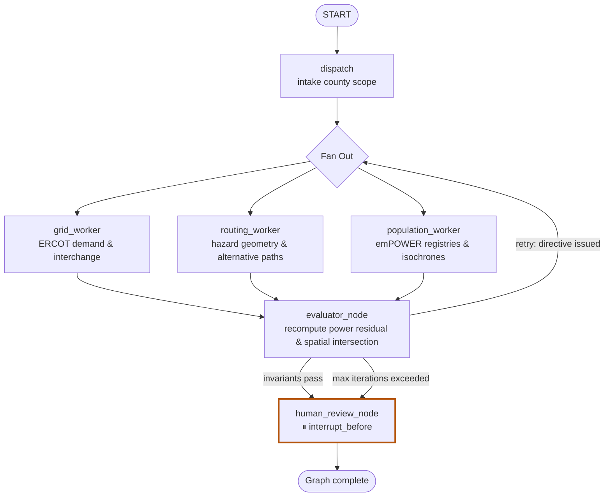
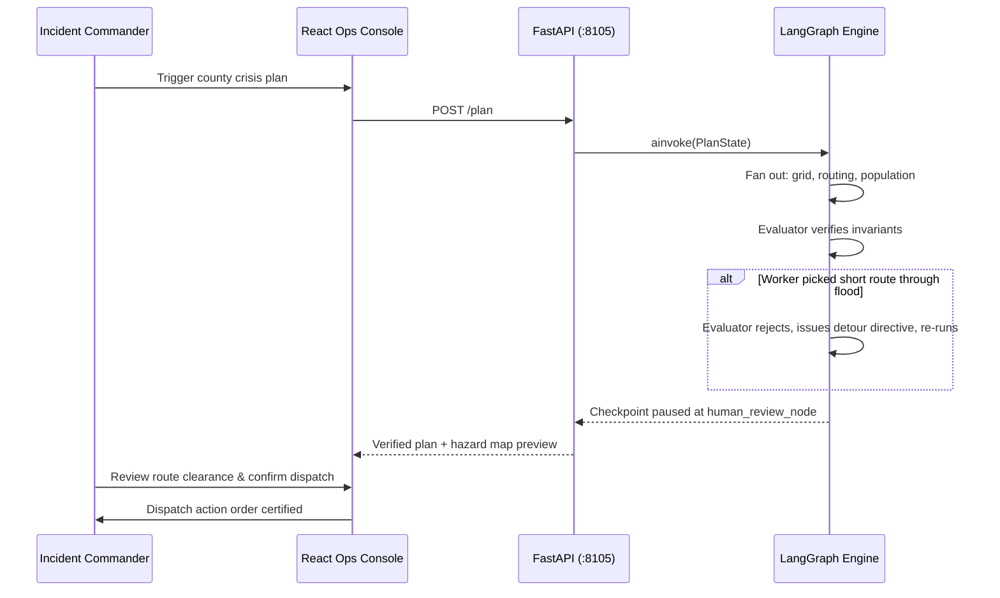
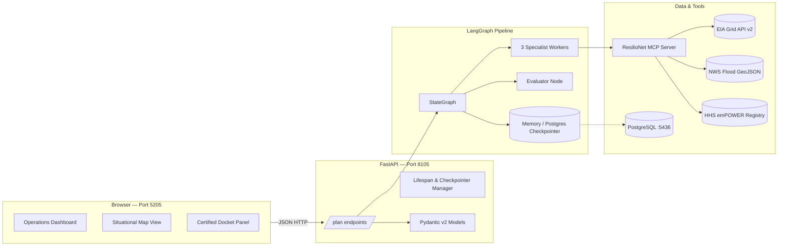

# ResilioNet

**A deterministic grid resilience and emergency dispatch engine for rural critical care — with an incident commander still in the loop.**

In rural counties during extreme weather, grid failures and flash floods happen simultaneously. In Bastrop County, Texas (on the ERCOT balancing authority), emergency vehicle transit times routinely exceed the survivability window for cardiac events, while medically fragile individuals on home ventilators or oxygen concentrators remain completely invisible to standard Computer Aided Dispatch (CAD). ResilioNet is software I built to fuse regional grid telemetry, National Weather Service flood polygons, and HHS emPOWER health vulnerability registries: balance grid interchange with mathematical zero-tolerance, enforce spatial exclusion zones around active floodwaters, and surface safety-certified dispatch routes for human incident commanders to certify.

This repo is the full monorepo: typed data contracts, a cyclic LangGraph multi-agent pipeline, an MCP open-data tools catalog, a FastAPI backend, and an operations-grade React telemetry dashboard where dispatchers sign off before any unit is routed.

---

## Operational showcase

These are the operational screens from the local dashboard running against the Bastrop County, Texas crisis fixture (`78602` and `78612` ZIP zones). The interface combines high-contrast telemetry with live map spatial layers and gate verification.

```
+----------------------------------------------------------------------------------------------------+
| RESILIONET OPS // BASTROP COUNTY, TX // ERCOT BALANCING AUTHORITY             [STATUS: CERTIFIED]  |
+----------------------------------------------------------------------------------------------------+
| [GRID TELEMETRY]                    | [NWS FLOOD HAZARD // COLORADO RIVER]                         |
| Demand:      42,000 MW              | Hazard Box: [30.05, -97.40] to [30.12, -97.30]               |
| Generation:  40,000 MW              | Short Route (via FM 969):  [INTERSECTS FLOOD - REJECTED]     |
| Interchange:  2,000 MW              | Detour Route (via HWY 71): [CLEARED - DETOUR CERTIFIED]      |
| Invariant Residual: 0.0 MW (BALANCED)| Transit Delta: +11 mins // Clearance: 3.4 km                 |
+----------------------------------------------------------------------------------------------------+
| [HHS emPOWER POPULATION TRIAGE]     | [EVALUATOR INVARIANT GATES]                                  |
| ZIP 78602: 42 vulnerable // 28 mins | [PASS] ERCOT Power Balance Identity (residual <= 1.0 MW)     |
|   -> TRIAGE: TIER 1 CRITICAL O2     | [PASS] Flood Polygon Spatial Exclusion (0 waypoints in box)  |
| ZIP 78612:  5 vulnerable // 12 mins | [PASS] emPOWER Isochrone Gate (Triage assigned on > 20 min)  |
|   -> TRIAGE: MONITORED STABLE       | [GATE] Paused at human_review_node for Commander Sign-Off   |
+----------------------------------------------------------------------------------------------------+
```

The frontend provides an interactive situational board ([`apps/web/src/components/situation-map.tsx`](apps/web/src/components/situation-map.tsx)), live telemetry rails ([`apps/web/src/components/telemetry.tsx`](apps/web/src/components/telemetry.tsx)), and a docket review panel where emergency coordinators certify the final action plan ([`apps/web/src/components/docket-view.tsx`](apps/web/src/components/docket-view.tsx)).

---

## What makes ResilioNet different

Most disaster response demos or "smart city" chatbots spit out LLM text recommendations based on outdated training data. ResilioNet treats power flow and floodwater as strict physical constraints that cannot be negotiated.

| | Generic Dispatch / LLM Tools | ResilioNet |
|---|---|---|
| **Grid Physics** | Guesswork or ignores inter-regional imports | Enforces **ERCOT Power Balance Identity** (`gen + interchange - demand == 0`) with **1.0 MW tolerance** |
| **Hazard Avoidance** | "Avoid flooded roads" text suggestions | Hard **2D bounding-box spatial geometry intersection**; any route entering active flood polygon is invalidated |
| **Vulnerable Populations** | Generic census heatmaps | Micro-targeted **HHS emPOWER electricity-dependent patient registries** joined with travel isochrones |
| **Workflow Topology** | One-shot text generation | **LangGraph cyclic multi-agent graph** with an independent actuarial evaluator node |
| **Incident Control** | Automated output dispatched directly | **Hard interrupt before docket finalization**; status `human_review` if invariants fail or iterations exhaust |
| **Data Authenticity** | Assumes 100% API uptime | **1,500 ms SLA with deterministic fallback** to validated regional telemetry snapshots |

Under the hood, worker agents propose operational plans, but the evaluator re-computes all physical and spatial invariants deterministically before human sign-off.

---

## Computational skills this project shows best

### 1. Physical systems modeling & invariant checking
- **Power identity functions**: verifies that `generation_mw + net_interchange_mw - demand_mw == 0.0` within `BALANCE_TOLERANCE_MW = 1.0` ([`packages/agents/src/resilionet_agents/invariants.py`](packages/agents/src/resilionet_agents/invariants.py)).
- Evaluator aggressively catches and rejects common grid shortcuts (such as dropping net interchange and calculating naive generation minus demand residuals).
- Zero tolerance for physical imbalance: an unclosed grid residual blocks plan certification immediately.

*Skill:* Translating electrical engineering power-flow constraints into deterministic software gate logic.

### 2. Spatial geometry & hazard intersection
- **Coordinate-level point-in-polygon verification** checking route waypoints against active NWS flood alert bounds ([`packages/agents/src/resilionet_agents/invariants.py`](packages/agents/src/resilionet_agents/invariants.py)).
- When the shortest path traverses the Colorado River flood polygon (`[30.05..30.12 lat, -97.4..-97.3 lon]`), the evaluator flags a safety breach and directs the graph to recalculate an unobstructed detour path.

*Skill:* Implementing computational geometry algorithms to enforce spatial life-safety boundaries.

### 3. Cyclic multi-agent orchestration (LangGraph)
- **Parallel worker fan-out**: `grid_worker`, `routing_worker`, and `population_worker` execute concurrently via LangGraph's `Send` API ([`packages/agents/src/resilionet_agents/graph.py`](packages/agents/src/resilionet_agents/graph.py)).
- **Explicit channel reducers**: state channels employ `replace` for domain sub-states, append-only for `audit_trail`, and list concatenation for `rejection_vector` ([`packages/agents/src/resilionet_agents/state.py`](packages/agents/src/resilionet_agents/state.py)).
- Durable Postgres checkpointer integration for resilient resume/recovery across server restarts.

*Skill:* Architecting multi-worker state graphs with clean fan-out/fan-in topologies and typed channel reducers.

### 4. Evaluator–optimizer reflection with bounded retries
- The evaluator node treats worker outputs as untrusted and independently re-verifies power residuals, route coordinates, and population triage classifications ([`packages/agents/src/resilionet_agents/evaluator.py`](packages/agents/src/resilionet_agents/evaluator.py)).
- Emits structured `re_evaluation_directive` instructions when workers propose unsafe shortcuts, driving targeted self-correction.
- Bounded to `MAX_ATTEMPTS = 3`; fails closed into `human_review` if convergence fails rather than looping infinitely.

*Skill:* Designing reflection and self-correction loops with deterministic termination guarantees.

### 5. Resilient open-data architecture & MCP integration
- Tool catalog implementing standardized interfaces to the U.S. Energy Information Administration (EIA v2), National Weather Service (NWS), and HHS emPOWER ([`packages/mcp_tools/src/resilionet_mcp/catalog.py`](packages/mcp_tools/src/resilionet_mcp/catalog.py)).
- Strict **1,500 ms SLA timeout** on external network calls with automatic fallback to high-fidelity regional cache snapshots, preserving confidence scores and timestamp lineage.

*Skill:* Designing fault-tolerant ingestion pipelines against erratic government web services during disasters.

### 6. Full-stack operational dashboard engineering
- High-performance FastAPI service with Pydantic request validation and async lifecycle management ([`packages/api/src/resilionet_api/main.py`](packages/api/src/resilionet_api/main.py)).
- React 19 operational UI featuring dark telemetry styling, interactive situational maps, live gate status rails, and docket export ([`apps/web/src/`](apps/web/src/)).
- 9 automated pytest tests covering invariant physics, hazard intersections, cyclic graph convergence, and API validation.

*Skill:* Delivering production-ready incident command interfaces backed by deterministic Python agent pipelines.

---

## At a glance

| Dimension | Specification |
|---|---|
| **Jurisdiction** | Bastrop County, Texas (`78602`, `78612`) // ERCOT Balancing Authority |
| **Grid Baseline** | EIA v2 API (ERCOT RTO region: 40,000 MW generation, 42,000 MW demand, 2,000 MW interchange) |
| **Hazard Layer** | NWS CAP alerts (Colorado River active flood polygon: `[30.05, -97.40]` to `[30.12, -97.30]`) |
| **Population Layer**| HHS emPOWER registry (electricity-dependent patients) + USDOT/OSM travel isochrones |
| **Output** | Certified detour transit route, zero-residual grid plan, prioritized triage manifest |
| **Guardrail** | Graph pauses before docket certification; fails closed to `human_review` on unresolved invariant errors |

---

## How an incident plan moves through the system

```mermaid
stateDiagram-v2
    direction LR
    [*] --> INTAKE: Enter County & Hazard Scope
    INTAKE --> FAN_OUT: Dispatch workers
    state FAN_OUT {
        direction TB
        GRID_WORKER: Grid Worker (ERCOT Power Balance)
        ROUTING_WORKER: Routing Worker (NWS Hazard Avoidance)
        POP_WORKER: Population Worker (HHS emPOWER Triage)
    }
    FAN_OUT --> EVALUATING: Converge state
    EVALUATING --> FAN_OUT: Invariant breach & iterations < 3
    EVALUATING --> HUMAN_REVIEW: Invariants fail & iterations >= 3 (fail-closed)
    EVALUATING --> AWAITING_COMMANDER: Invariants pass
    AWAITING_COMMANDER --> CERTIFIED: Incident Commander signs off
    CERTIFIED --> [*]
    HUMAN_REVIEW --> [*]
```



---

## The agent pipeline (LangGraph)

ResilioNet uses a cyclic graph architecture where workers formulate tactical plans and an evaluator enforces physical and spatial laws.



### Verification sequence



---

## Architecture



---

## What the evaluator actually checks

| Category | Physical Authority / Standard | Exact Invariant Rule |
|---|---|---|
| **Grid Power Balance** | ERCOT Balancing Authority | `residual = (generation_mw + net_interchange_mw) - demand_mw`. Residual must be within `+/- 1.0 MW`. Dropping interchange is immediately rejected. |
| **Hazard Avoidance** | NWS Flood Polygon | `point_in_hazard(lat, lon, bbox)`. Every waypoint in recommended route is tested. Zero intersection permitted. |
| **Population Triage** | HHS emPOWER & USDOT | `triage = empower_count > 0 and travel_minutes > 20`. Categorizes into Tier 1 Critical O2 priority. |
| **Data Integrity** | Regional SLA Standards | Telemetry confidence score and source lineage (`live` vs `cache`) must be preserved in audit trail. |

If invariant errors persist after 3 cycles, the graph terminates into `human_review` with an explicit `rejection_vector`.

---

## Tech Stack

| Layer | Technologies |
|---|---|
| **Frontend** | React 19, TypeScript, Vite, Tailwind CSS, Lucide Icons, Radix UI primitives, Situational Map visualizer |
| **API** | FastAPI, Pydantic v2, Uvicorn, structured HTTP error handling |
| **Agents & Workflow** | LangGraph `StateGraph`, `Send` API fan-out, custom channel reducers, checkpoint persistence |
| **Tooling & MCP** | Model Context Protocol (`resilionet_mcp`), EIA / NWS / emPOWER JSON fixtures, `uv`, `pytest`, `ruff`, `mypy` |
| **Storage** | PostgreSQL 16 (port `5436`) via Docker Compose, LangGraph checkpoint tables |

---

## Try it locally

### 1. Environment & Database

```bash
# Start PostgreSQL (port 5436)
docker compose up postgres -d

# Copy environment template
cp .env.example .env
```

### 2. Run backend & frontend

You can use the unified dev launcher:

```bash
./scripts/dev.sh
```

Or run each service individually:

```bash
# Backend API (port 8105)
uv sync
uv run uvicorn resilionet_api.main:app --host 127.0.0.1 --port 8105 --reload

# Frontend Web App (port 5205)
cd apps/web
npm install
npm run dev -- --port 5205
```

| Service | URL | Notes |
|---|---|---|
| **Web Interface** | http://localhost:5205 | Interactive situational board, telemetry monitor, plan dispatch |
| **API Server** | http://localhost:8105 | Interactive docs at `/docs`, health probe at `/healthz` |
| **PostgreSQL** | `localhost:5436` | Database `resilionet`, user `resilionet` |

---

## Web interface & routes

| Component | Purpose |
|---|---|
| **Operations Header** | Incident title, ERCOT balancing status, active county, and certification state |
| **Situational Map** | Real-time map displaying flood hazard bounding box, rejected short route, and certified detour route |
| **Telemetry Rail** | High-contrast gauges for generation, demand, net interchange, and calculated residual MW |
| **Triage Manifest** | Ranked list of vulnerable emPOWER patients filtered by travel time isochrones |
| **Docket View** | Action order preview with commander sign-off and audit log export |

---

## Tests

The test suite covers pure invariant physics, multi-agent cyclic execution with self-correction, and FastAPI routes:

```bash
uv run pytest
```

### Test coverage breakdown:
- **`test_invariants.py` (4 tests)**: Verifies that interchange closes the ERCOT identity, dropping interchange triggers a balance failure, short routes intersect the flood polygon while detours clear it, and population isochrone bands trigger triage correctly.
- **`test_graph.py` (2 async tests)**: Verifies that the evaluator rejects the unsafe flooded route on iteration 0, forces self-correction to the safe detour on iteration 1, and fails closed into `human_review` when an unsafe plan is forced.
- **`test_api.py` (3 tests)**: Tests `/healthz`, successful county plan certification via the API, and 422 validation on empty county payloads.

---

## Repository map

```
ResilioNet/
├── apps/
│   └── web/                   React 19 + Vite operations console
│       ├── src/components/    OpsHeader, SituationMap, Telemetry, DocketView, GateRail
│       └── src/lib/           API client, map projection utilities, theme hooks
├── packages/
│   ├── agents/                LangGraph agent implementation
│   │   └── src/resilionet_agents/
│   │       ├── invariants.py  Physical power balance & spatial hazard exclusion
│   │       ├── state.py       PlanState TypedDict with custom reducers
│   │       ├── workers.py     Grid, routing, and population worker nodes
│   │       ├── evaluator.py   Physical gate evaluator node with directive generation
│   │       └── graph.py       StateGraph compilation & interrupt routing
│   ├── api/                   FastAPI service layer
│   │   └── src/resilionet_api/
│   │       └── main.py        Plan endpoints, lifespan checkpointer, Pydantic schemas
│   └── mcp_tools/             Model Context Protocol tools & data fixtures
│       └── src/resilionet_mcp/
│           ├── catalog.py     EIA / NWS / emPOWER catalog with 1500ms fallback
│           └── fixtures/      Bastrop County, TX telemetry fixture
├── docs/
│   └── blueprint.pdf          Original architectural specification
├── scripts/
│   └── dev.sh                 Unified development launcher
├── tests/                     Complete pytest test suite (9 tests)
├── docker-compose.yml         PostgreSQL 16 container definition
└── pyproject.toml             uv workspace root configuration
```

---

## Why I built this

During grid emergencies, life-safety operations break down at the seams between separate institutions. Grid operators balance megawatts, weather forecasters publish storm bulletins, and paramedics drive ambulances — but almost no system joins these datasets into deterministic routing before a vehicle departs.

I built ResilioNet to prove that agentic workflows can enforce real-world physical and geographic invariants without hallucination. By placing hard mathematical gates on grid balance and floodwater avoidance, ResilioNet provides emergency coordinators with vetted, verifiable options when seconds matter most.

---

<p align="center">
  <sub>Built with care for rural communities and the first responders who protect them.</sub>
</p>
