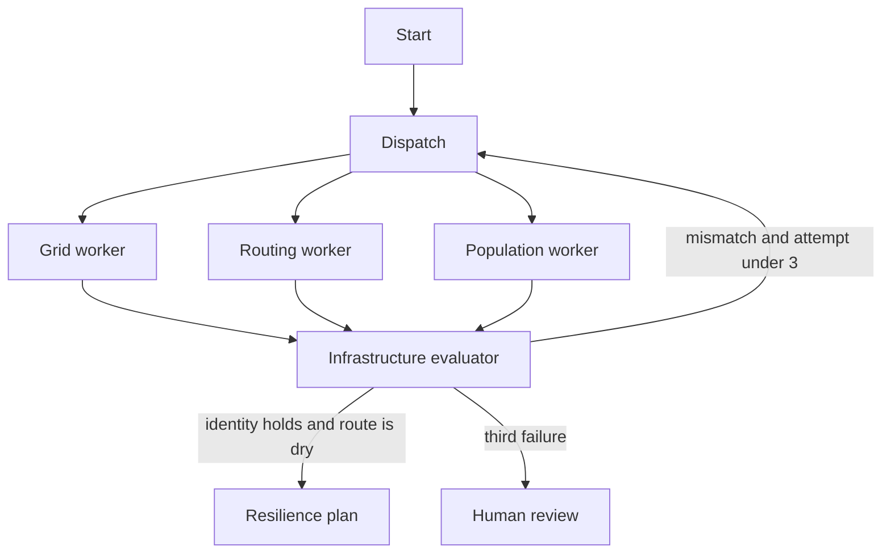

# ResilioNet

Dispatch and grid sentinel for Bastrop County, Texas, on the ERCOT balancing authority. The evaluator checks that generation, demand, and interchange balance, and that a recommended route stays out of an active flood polygon.

The blueprint PDF is in [`docs/blueprint.pdf`](docs/blueprint.pdf). The PDF's WebSocket stream is a later step. This scaffold returns the plan from one POST. The UI does not hold a socket open.

## Crisis

Rural ambulance times already run past the window that matters in cardiac arrest. Storms trip feeders at the same time, and the people who depend on home oxygen or a ventilator are not on the dispatch map.

## Open-data anchors

| Source | Endpoint | Scaffold |
| --- | --- | --- |
| EIA grid API v2 | `https://api.eia.gov/v2/electricity/rto/` | Cached ERCOT hour: 42,000 MW demand, 40,000 MW generation, 2,000 MW interchange |
| NWS alerts | `https://api.weather.gov/alerts` | One flood rectangle, Colorado River |
| HHS emPOWER | county / ZIP aggregates | ZIP 78602 has 42 electricity-dependent residents; 78612 has 5 |
| Roads | OSM / USDOT | Two fixture routes, not a live router |

`EIA_API_KEY` is in `.env.example` and unused. A live call that exceeds 1,500 ms returns the cache with confidence 0.4 and `fallback_reason=eia_timeout_or_error`.

## Architecture



Residual megawatts are `generation + net interchange - demand`. The fixture residual is 0, inside a 1 MW tolerance. The first pass drops interchange and calls a 2,000 MW gap "close enough". That pass is rejected.

The first route is the shorter path through the flood rectangle. The retry is the detour. A ZIP is triaged when its emPOWER count is positive and travel from the station is over 20 minutes. Bands are 10, 20, and 30 minutes.

`AsyncPostgresSaver` is used when `DATABASE_URL` is set.

## Failure mode

Federal APIs drop packets in the storm they are supposed to describe. The client times out at 1,500 ms, serves the Postgres-shaped cache (in memory in this scaffold), and the plan carries the lower confidence so a dispatcher can see the degradation.

## 4-week MVP checklist

- [x] Bastrop / ERCOT fixture
- [x] Power-balance gate
- [x] Hazard intersection gate
- [x] 10 / 20 / 30 minute bands and emPOWER triage
- [x] 1,500 ms fallback with a confidence flag
- [ ] EIA key and a real hourly series
- [ ] NWS alert polygons instead of the fixture rectangle
- [ ] Road-network isochrones, then WebSocket updates for the board

## Run

```bash
cp .env.example .env
docker compose up -d
uv sync
uv run pytest
./scripts/dev.sh
```

API `http://127.0.0.1:8105/health`. UI `http://127.0.0.1:5205`.

Python is managed with `uv` only.
